<!-- Mesma identidade visual de profabnerlucas.com. As imagens de assets/ são geradas por scripts/gerar_svgs.py. -->

  

  
  
  
  
  

<picture>
  <source media="(prefers-color-scheme: dark)" srcset="assets/faixa-escuro.svg"/>
  
</picture>

  

<picture>
  <source media="(prefers-color-scheme: dark)" srcset="assets/titulos/01-sobre-escuro.svg"/>
  
</picture>

Sou professor do **Eixo Informação e Comunicação do IFPA Campus Breves** e mestre em Ciência da Computação na linha de **Inteligência Computacional**.

Gosto de transformar conceitos abstratos — projeções 3D, protocolos de rede, redes neurais — em experiências que cabem no navegador e que os estudantes podem **tocar, quebrar e reconstruir**.

Na pesquisa, trabalho com **Deep Learning**, redes neurais artificiais, sinais cerebrais (**EEG**) e **robótica**, sempre buscando aplicações que façam sentido para a realidade amazônica.

`Inteligência Computacional` `Deep Learning` `Redes Neurais` `Robótica` `Computação Gráfica` `Desenvolvimento Web`

> Este perfil usa a mesma identidade visual do meu site. O código dele também é aberto: [abner-lucas/portfolio](https://github.com/abner-lucas/portfolio).

 
 

<picture>
  <source media="(prefers-color-scheme: dark)" srcset="assets/titulos/02-laboratorio-escuro.svg"/>
  
</picture>

  
  

  
  

  
  

  Código-fonte:
  <a href="https://github.com/abner-lucas/missao-osi">missao-osi</a> ·
  <a href="https://github.com/abner-lucas/geo3d-lab-interativo-cg">geo3d-lab-interativo-cg</a> ·
  <a href="https://github.com/abner-lucas/letramento-digital-em-ia">letramento-digital-em-ia</a> ·
  <a href="https://github.com/abner-lucas/monitor-acai">monitor-acai</a> ·
  <a href="https://github.com/abner-lucas/computacao-grafica">computacao-grafica</a> ·
  <a href="https://github.com/abner-lucas/programacao-web">programacao-web</a>

 

<picture>
  <source media="(prefers-color-scheme: dark)" srcset="assets/titulos/03-pesquisa-escuro.svg"/>
  
</picture>

| Ano | Trabalho | Tipo |
| :-: | :-- | :-- |
| 2026 | **Morfometria Computacional e IA:** otimização de peneiras no despolpamento do açaí em Breves-PA · *em andamento* | Projeto de pesquisa |
| 2026 | [**MonitorAçaí:** rodízio de sensores de umidade do solo no SAF de açaí do Campus Breves](https://github.com/abner-lucas/monitor-acai) · *em andamento* | Pesquisa aberta |
| 2024 | [Extração de características de EEG com DWT e classificação de grupos controle e superdotados](https://github.com/abner-lucas/EEG-Feature-Extraction-Classification) | Pesquisa aberta |
| 2024 | [Predição de séries temporais de EEG com redes MLP](https://github.com/abner-lucas/EEG-Time-Series-Prediction) | Pesquisa aberta |
| 2024 | [Pré-processamento de EEG (BrainVision) com MNE-Python](https://github.com/abner-lucas/EEG-Preprocessing-MNE) | Pesquisa aberta |
| 2024 | [Otimização de hiperparâmetros de redes neurais com PSO](https://github.com/abner-lucas/PSO-Hyperparameter-Optimization-Classification) | Pesquisa aberta |
| 2023 | [**Deep Learning Applied to ERP in the Search for Spatial Intelligence Signatures**](https://doi.org/10.1007/978-3-031-27524-1_77) · Springer | Capítulo de livro |
| 2023 | **Consulta Inteligente:** chatbot com IA para atendimento à comunidade do IFPA Campus Breves | Projeto de pesquisa |

  Orientações de TCC, extensão e a lista completa em <a href="https://profabnerlucas.com/pesquisa">profabnerlucas.com/pesquisa</a> ·
  mais estudos abertos: <a href="https://github.com/abner-lucas/Tabu-Search-CVRP">Busca Tabu</a>,
  <a href="https://github.com/abner-lucas/Genetic-Algorithm-CVRP">Algoritmo Genético</a>,
  <a href="https://github.com/abner-lucas/Multilayer-Perceptron-Classification">MLP</a>,
  <a href="https://github.com/abner-lucas/MegaDetector-Animal-CameraTrap">MegaDetector</a> e
  <a href="https://github.com/abner-lucas/tp-cruzi-db">T. cruzi DB</a>

 

<picture>
  <source media="(prefers-color-scheme: dark)" srcset="assets/titulos/04-github-escuro.svg"/>
  
</picture>

  <picture>
    <source media="(prefers-color-scheme: dark)" srcset="https://github-readme-stats.vercel.app/api?username=abner-lucas&show_icons=true&include_all_commits=true&count_private=true&hide_border=true&border_radius=24&rank_icon=github&bg_color=0e1714&title_color=3dd69b&icon_color=c8f05a&text_color=e6efea&ring_color=c8f05a&locale=pt-br"/>
    
  </picture>
  <picture>
    <source media="(prefers-color-scheme: dark)" srcset="https://github-readme-stats.vercel.app/api/top-langs/?username=abner-lucas&layout=compact&langs_count=6&size_weight=0&count_weight=1&exclude_repo=tp-cruzi-db&hide=purebasic%2Cplpgsql&hide_border=true&border_radius=24&bg_color=0e1714&title_color=3dd69b&text_color=e6efea&locale=pt-br"/>
    
  </picture>

  <picture>
    <source media="(prefers-color-scheme: dark)" srcset="https://streak-stats.demolab.com?user=abner-lucas&hide_border=true&border_radius=24&background=0e1714&ring=c8f05a&fire=ff6b4a&currStreakLabel=c8f05a&sideLabels=e6efea&currStreakNum=e6efea&sideNums=e6efea&dates=9db1a7&stroke=1f2f29&locale=pt_BR"/>
    
  </picture>

<!-- Gerado pela GitHub Action em .github/workflows/snake.yml (branch "output") -->

  <picture>
    <source media="(prefers-color-scheme: dark)" srcset="https://raw.githubusercontent.com/abner-lucas/abner-lucas/output/github-snake-dark.svg"/>
    
  </picture>

 

  

  

